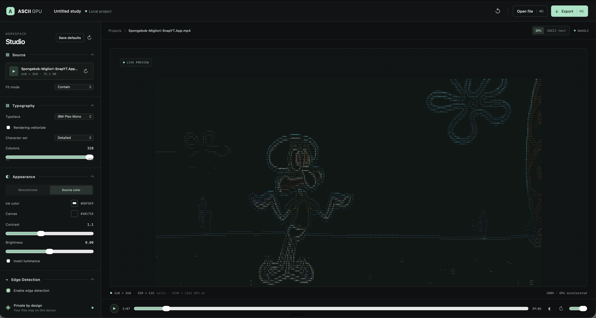

<div align="center">

# ASCII GPU Studio

**Trasforma immagini e video in arte ASCII, direttamente nel browser.**

Uno studio locale-first con rendering WebGL2, anteprima testuale e audio video originale.

[Avvio rapido](#avvio-rapido) · [Funzionalità](#funzionalità) · [Verifiche](#verifiche) · [Stato del progetto](#stato-del-progetto)

</div>

<p align="center">
  
</p>

## In breve

ASCII GPU Studio è un'applicazione web per esplorare e rifinire conversioni ASCII di immagini e video. I media vengono elaborati localmente: non sono caricati su un server. La preview GPU disegna glifi reali tramite WebGL2; in alternativa, una modalità testuale produce una griglia monospace che puoi selezionare e copiare.

## Funzionalità

- **Immagini e video locali** — apri un file o trascinalo nello Studio. I video vengono riprodotti con l'audio originale del browser, sincronizzato con i fotogrammi.
- **Rendering WebGL2** — atlante dei glifi rasterizzato ad alta risoluzione (4×–8×, nei limiti della GPU), selezione della densità e proporzioni delle celle basate sulle metriche del font.
- **Controlli di resa** — regola charset, griglia da 32 a 320 colonne, famiglia del font, modalità colore, contrasto, luminosità, inversione e adattamento dell'immagine. La dimensione dei caratteri è gestita automaticamente.
- **Anteprima ASCII testuale** — passa dalla preview GPU al testo monospace normale, pronto da selezionare e copiare.
- **Esportazione** — salva un progetto `.ascii` con sorgente, impostazioni e miniatura oppure esporta la preview in PNG.
- **Player Vue riutilizzabile** — nel repository trovi il componente e un esempio funzionante.

## Avvio rapido

Requisiti: **Node.js 22–24** e **pnpm 11.24.0**.

```sh
pnpm install
pnpm dev
```

Apri l'indirizzo locale mostrato da Vite, quindi importa un'immagine o un video. Regola la resa dal pannello laterale e usa **Export** per salvare il progetto modificabile o **Export PNG** per l'immagine renderizzata.

## Verifiche

```sh
pnpm lint
pnpm test
pnpm build
pnpm format:check
```

I test end-to-end usano Playwright e Chromium:

```sh
pnpm exec playwright install chromium
pnpm test:e2e
```

La suite copre rendering WebGL2, densità dei glifi, anteprima testuale, esportazione/importazione `.ascii`, PNG, player Vue e controlli video. L'audio viene riprodotto dal media element nativo: l'uscita udibile dipende dalle policy del browser e del dispositivo.

## Formato `.ascii`

Il progetto `.ascii` è un archivio ZIP versionato che contiene il manifest, il media originale, le impostazioni della scena e una miniatura PNG. L'importazione applica limiti a dimensione, numero di elementi e percorsi estratti. I file restano sul dispositivo.

## Stack

JavaScript ES Modules · Vue 3 · Vite · WebGL2 · Canvas 2D · Playwright

## Stato del progetto

Lo Studio è funzionante, ma non tutte le funzionalità previste sono state implementate. In particolare, non sono ancora disponibili esportazione WebM/TXT/SVG, cronologia undo/redo, selezione edge-aware, ripristino del contesto WebGL e una matrice E2E Firefox/WebKit. Il componente Vue è un esempio interno al repository, non ancora un pacchetto pronto per la pubblicazione indipendente.

- [Stato e prossimi interventi](docs/STATUS.md)
- [Backlog](docs/TODO.md)
- [Delivery report: funzionalità verificate e limiti](docs/DELIVERY_REPORT.md)
- [Architettura](docs/ARCHITECTURE.md)
- [API del componente Vue](docs/API.md)

## Licenza

Distribuito con licenza [MIT](LICENSE).
